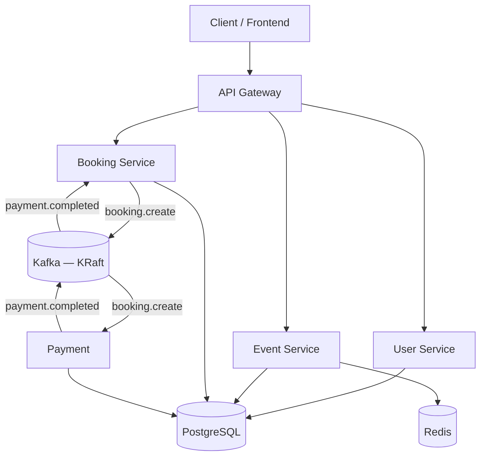
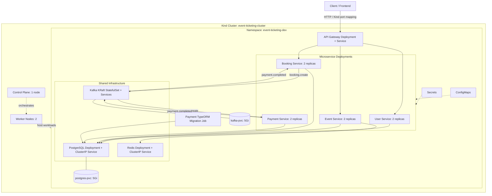

# Event Ticketing System — Infrastructure & DevOps

Infrastructure configuration and deployment resources for the **Event Ticketing System**, a microservices-based application built with Spring Boot and NestJS.

This repository supports local development with Docker Compose and a multi-node Kubernetes environment using **Kind**. It also contains reusable Helm charts for a separate Kind-based deployment environment and serves as the home for planned cloud infrastructure, deployment automation, and observabilit work.

## Current implementation status

| Area | Status | Details |
|---|---|---|
| Local infrastructure | Implemented | Docker Compose for PostgreSQL, Redis and Kafka |
| Local application stack | Implemented | Separate Docker Compose application configuration |
| Local Kubernetes cluster | Implemented | Kind cluster with one control-plane and two worker nodes |
| Kubernetes infrastructure | Implemented | PostgreSQL, Redis and Kafka |
| Kubernetes microservices | Implemented | API Gateway, User, Event, Booking and Payment services |
| Kubernetes configuration | Implemented | Namespaces, ConfigMaps, Secrets, Services and persistent storage |
| Database migration | Implemented | One-off Kubernetes Job for Payment Service TypeORM migrations |
| CI | Implemented in service repositories | GitHub Actions test pipelines |
| AWS infrastructure | Planned | EKS, RDS, MSK, ElastiCache and ECR |
| Helm charts | Implemented locally | Eight Helm releases in an isolated Kind cluster; validation and deployment completed |
| Terraform and GitOps | Planned | Infrastructure provisioning and Argo CD automated delivery |
| Observability | Planned | Prometheus, Grafana and Loki |
| Helm end-to-end booking/payment verification | In progress | Kafka consumer connectivity verified; business-level idempotency fix pending |

> **Scope:** This README covers two separate local Kind environments: the original raw-manifest cluster (`event-ticketing-cluster`) and the Helm cluster (`event-ticketing-helm-cluster`). AWS resources, GitOps and observability components are roadmap items, not claimed as deployed.

## Architecture



Kafka event processing is asynchronous. A successful end-to-end booking/payment workflow requires the relevant topics, consumers, database migrations and event handlers to be configured and verified.

## Technology stack

| Layer | Technology |
|---|---|
| Application services | Spring Boot (Java 21), NestJS |
| Containers | Docker, Docker Compose |
| Kubernetes | Kind, kubectl, Kubernetes manifests, Helm charts |
| Messaging | Apache Kafka in KRaft mode |
| Data | PostgreSQL, Redis |
| CI | GitHub Actions |
| Planned IaC / cloud | Terraform, AWS EKS, RDS, MSK, ElastiCache, ECR |
| Delivery / planned observability | Helm (implemented locally); Argo CD, Prometheus, Grafana, Loki (planned) |

## 1. Local development with Docker Compose

### Prerequisites

- Docker Engine or Docker Desktop with Compose support
- Git

The infrastructure and application Compose stacks use the shared `event-ticketing-network` bridge network. Application containers can resolve infrastructure components by their service DNS names.

### Start infrastructure and applications separately (recommended)

```bash
docker compose -f docker-compose.infra.yml up -d
docker compose -f docker-compose-app.yml up -d
```

### Start both stacks together

```bash
docker compose -f docker-compose.infra.yml -f docker-compose-app.yml up -d
```

### Stop the environment

```bash
docker compose -f docker-compose.infra.yml -f docker-compose-app.yml down --remove-orphans
```

**Warning:** Adding `-v` removes Compose-managed volumes and can delete local database or messaging data. Only use it when an intentional data reset is required.

## 2. Local Kubernetes environment (Kind)

### Cluster topology

| Setting | Value |
|---|---|
| Cluster name | `event-ticketing-cluster` |
| Control-plane nodes | 1 |
| Worker nodes | 2 |
| Application namespace | `event-ticketing-dev` |
| Host port mapping | `127.0.0.1:9090` → Kind control-plane port `30080` |

The Kind configuration maps the host port to a Kubernetes node port; the actual application exposed on that port depends on the currently deployed NodePort Service. Verify the Service configuration rather than assuming a particular application is reachable there.

### Deployed Kubernetes architecture diagram



> **Diagram scope:** This is a logical view of the deployed Kind environment, not a fixed per-node Pod placement map. Kubernetes schedules workloads on eligible nodes; the Kafka StatefulSet uses stable broker identity and persistent storage.

### Prerequisites

- Docker Engine / Docker Desktop
- `kind`
- `kubectl`
- Built application images available to the Kind cluster (via `kind load docker-image` or a registry)
- Kubernetes manifests from this repository

### Create or inspect the cluster

Use the repository's Kind configuration file (adjust the path to its actual location):

```bash
kind create cluster --name event-ticketing-cluster --config <path-to-kind-config.yaml>
kubectl config use-context kind-event-ticketing-cluster
kubectl get nodes -o wide
```

If the cluster already exists, skip creation and select its context.

### Namespace

The application resources are deployed in the `event-ticketing-dev` namespace, labeled `environment=development`.

```bash
kubectl get namespace event-ticketing-dev
kubectl get all -n event-ticketing-dev
```

Apply the namespace manifest before other namespaced resources. Use the actual paths in this repository when applying manifests.

## 3. Kubernetes resources

### Infrastructure workloads

| Component | Kubernetes resources | Notes |
|---|---|---|
| PostgreSQL | Deployment, ClusterIP Service, PVC, credentials Secret | Persistent relational data; databases used by microservices |
| Redis | Deployment, Service | Shared caching infrastructure |
| Kafka | StatefulSet, headless Service, client Service, PVC | Single-broker KRaft deployment for local development |

**Kafka configuration:**

- Image: `confluentinc/cp-kafka:7.5.0`
- Broker endpoint for in-cluster clients: `kafka:9092`
- Advertised broker endpoint: `kafka-0.kafka-headless.event-ticketing-dev.svc.cluster.local:9092`
- Broker and controller ports: `9092` and `9093`
- Single-broker replication factor: `1` (local development only)
- Topic auto-creation: disabled (`KAFKA_AUTO_CREATE_TOPICS_ENABLE=false`)
- Persistent volume claim: `kafka-pvc`, 5 GiB
- **Important:** Set `spec.template.spec.enableServiceLinks: false` on the Kafka StatefulSet to prevent Kubernetes from injecting `KAFKA_PORT`, which Confluent's startup script treats as a deprecated setting and exits with code 1.

The local single-broker Kafka deployment is **not highly available** and is not a production topology.

### Application workloads

| Workload | Technology | Container port | Kubernetes resource |
|---|---|---:|---|
| API Gateway | Spring Cloud Gateway | 9090 | Deployment + Service |
| User Service | Spring Boot | 8081 | Deployment + Service |
| Event Service | Spring Boot | 8082 | Deployment + Service |
| Booking Service | Spring Boot | 8083 | Deployment + Service |
| Payment Service | NestJS | 8084 | Deployment; verify Service availability per environment |

Services communicate internally through Kubernetes DNS rather than Eureka. The application Deployments use Kubernetes configuration resources and service endpoints to connect to shared infrastructure.

### ConfigMaps and Secrets

**ConfigMaps** hold non-sensitive environment configuration such as service ports, database hosts, Kafka bootstrap addresses and application settings. Examples include `payment-service-config` and the service-specific configuration used by Spring Boot workloads.

**Secrets** hold sensitive values such as database credentials and JWT signing material. Examples include `postgres-credentials` and `jwt-secret`.

Never commit real credentials, JWT secrets, or production `.env` files. The local manifests should use development-only placeholders or a secure secret provisioning workflow. Kubernetes Secrets are not automatically equivalent to a managed secrets vault.

### Persistent storage

PostgreSQL and Kafka use PersistentVolumeClaims so data can survive container restarts and ordinary Pod recreation. For example:

- PostgreSQL: `postgres-pvc` (5 GiB in the local setup)
- Kafka: `kafka-pvc` (5 GiB)

Deleting a PVC or its underlying storage can permanently remove data. The Kind local-path StorageClass is intended for development and does not replace production storage and backup strategies.

### Database migrations

Payment Service database schema changes are executed by a **one-off Kubernetes Job**:

- Job: `payment-service-migration-v1`
- Image: `event-ticketing-payment-service:1.0.1` (local deployment version)
- Tool: TypeORM CLI
- Data source: `dist/database/data-source.js`

The migration command is:

```bash
./node_modules/.bin/typeorm migration:run -d dist/database/data-source.js
```

The Job creates/updates the payment database schema. The verified tables include `payments`, `processed_events`, `outbox_events` and `typeorm_migrations`.

```bash
kubectl get jobs -n event-ticketing-dev
kubectl logs job/payment-service-migration-v1 -n event-ticketing-dev
```

A migration Pod showing `0/1 Completed` is expected after the Job finishes successfully; it is not a running application Pod. Check Job conditions and logs to confirm success.

## 4. Deployment workflow

The exact manifest filenames and directory layout may differ by branch. Apply resources in dependency order using their real repository paths:

1. **Cluster and namespace:** Create the Kind cluster and apply the namespace.
2. **Configuration:** Apply development ConfigMaps and provision Secrets securely.
3. **Storage and infrastructure:** Apply PVCs, PostgreSQL, Redis and Kafka resources; wait for readiness.
4. **Kafka topics:** Provision required topics explicitly because auto-creation is disabled.
5. **Database migrations:** Run and verify the Payment Service migration Job.
6. **Application images:** Build/load images into Kind or configure a reachable registry.
7. **Microservices:** Apply User, Event, Booking, Payment and API Gateway Deployments and Services.
8. **Verification:** Check Pod readiness, logs, Service endpoints and end-to-end event flow.

### Loading a local image into Kind

```bash
kind load docker-image event-ticketing-payment-service:1.0.1 --name event-ticketing-cluster
```

Repeat for other locally built service images, using their actual tags.

### Provision Kafka topics

At minimum, the booking/payment integration uses `booking.create` and `payment.completed`. Create them after Kafka is ready; for a single local broker, use replication factor 1:

```bash
kubectl exec kafka-0 -n event-ticketing-dev -- \
  kafka-topics --bootstrap-server localhost:9092 \
  --create --if-not-exists --topic booking.create \
  --partitions 3 --replication-factor 1

kubectl exec kafka-0 -n event-ticketing-dev -- \
  kafka-topics --bootstrap-server localhost:9092 \
  --create --if-not-exists --topic payment.completed \
  --partitions 3 --replication-factor 1
```

Additional topics may be required by other application events. In a repeatable environment, topic provisioning should be automated through an infrastructure bootstrap step or Job rather than relying on manual commands.

### Inspect deployment status

```bash
kubectl get nodes
kubectl get pods -n event-ticketing-dev
kubectl get deployments,statefulsets,services,jobs,pvc -n event-ticketing-dev
kubectl get configmaps,secrets -n event-ticketing-dev
kubectl logs statefulset/kafka -n event-ticketing-dev --tail=100
```

Avoid printing Secret values in logs or screenshots.

## 5. Event-driven booking and payment flow

1. Booking Service creates a booking and publishes a `booking.create` event using the Outbox Pattern.
2. Payment Service's NestJS Kafka consumer subscribes to `booking.create` and processes the payment workflow.
3. Payment Service persists payment state and outgoing events using its database and outbox mechanism.
4. Payment Service's Outbox Publisher publishes `payment.completed` when payment completion is recorded.
5. Booking Service listens for `payment.completed` (consumer group `booking-service-group`) and updates the booking state.

Kafka topic presence and consumer group registration alone do **not** prove end-to-end processing. Verify application logs, committed offsets, database state, and idempotent handling. With multiple Payment Service replicas, the Outbox Publisher must coordinate event claims to prevent duplicate publishing.

### Kafka diagnostics

```bash
# List topics
kubectl exec kafka-0 -n event-ticketing-dev -- \
  kafka-topics --bootstrap-server localhost:9092 --list

# Inspect a topic
kubectl exec kafka-0 -n event-ticketing-dev -- \
  kafka-topics --bootstrap-server localhost:9092 \
  --describe --topic payment.completed

# List consumer groups
kubectl exec kafka-0 -n event-ticketing-dev -- \
  kafka-consumer-groups --bootstrap-server localhost:9092 --list

# Inspect the NestJS consumer group
kubectl exec kafka-0 -n event-ticketing-dev -- \
  kafka-consumer-groups --bootstrap-server localhost:9092 \
  --describe --group payment-service-group-server-server

# Follow Payment Service logs
kubectl logs -f -n event-ticketing-dev -l app=payment-service \
  --prefix=true --max-log-requests=10
```

**NestJS naming note:** The Kafka server transport appends a `-server` suffix to the configured consumer group ID. With a configured `payment-service-group-server`, the observed group was `payment-service-group-server-server`.

## 6. Troubleshooting notes

### Kafka CrashLoopBackOff: deprecated `port`

**Symptom:**

```text
Running in KRaft mode...
port is deprecated. Please use KAFKA_ADVERTISED_LISTENERS instead.
```

**Cause:** Kubernetes can inject a `KAFKA_PORT` environment variable from a Service named `kafka`. Confluent's Kafka startup script treats that variable as deprecated and exits with code 1.

**Fix:** Add this setting to the Kafka StatefulSet Pod template:

```yaml
spec:
  template:
    spec:
      enableServiceLinks: false
```

This disables service-linked environment variable injection, **not** Kubernetes DNS. Preserve existing PVCs and KRaft metadata while troubleshooting.

### Kafka producer metadata error

**Symptom:** `This server does not host this topic-partition`.

Check that the destination topic exists, partitions have leaders, and the broker's advertised listener is resolvable/reachable from application Pods. In this local environment, Kafka topic auto-creation is disabled.

### Migration Job shows `Completed`

A finished migration Pod showing `0/1 Completed` is normal. Review the Job status and logs; do not expect it to remain Running.

### Unexpected Pod restarts or `Unknown` status

Check node readiness, Pod events and recent container logs:

```bash
kubectl get nodes -o wide
kubectl get pods -n event-ticketing-dev -o wide
kubectl describe pod <pod-name> -n event-ticketing-dev
kubectl logs <pod-name> -n event-ticketing-dev --previous
```

## 7. Helm-based Kubernetes deployment (separate Kind environment)

Helm packages Kubernetes resource templates into versioned **charts** and manages their installation, upgrades and release history. The Helm implementation lives alongside the original `k8s/` manifests; it does **not** replace or modify the original Kind deployment. This separation allows the two deployment approaches to be compared and tested independently.

### 7.1 Implementation status and environment isolation

| Setting | Raw Kubernetes manifests | Helm deployment |
|---|---|---|
| Kind cluster | `event-ticketing-cluster` | `event-ticketing-helm-cluster` |
| kubectl context | `kind-event-ticketing-cluster` | `kind-event-ticketing-helm-cluster` |
| Namespace | `event-ticketing-dev` | `event-ticketing-helm-dev` |
| Control-plane / worker nodes | 1 / 2 | 1 / 2 |
| Host-facing API Gateway | `http://localhost:9090` | `http://localhost:9091` |
| Deployment mechanism | `kubectl apply` | Helm charts and releases |

**Do not mix cluster contexts or namespaces.** All Helm commands below explicitly select the Helm cluster. Do not delete or modify the original `k8s/` environment while following this guide.

### 7.2 Prerequisites

- Docker Engine or Docker Desktop, Kind, `kubectl` and Helm 3.
- Built service images, or access to an image registry containing the required versions.
- The separate Helm Kind cluster created using `helm/cluster/kind.helm.cluster.yaml`.
- The `event-ticketing-helm-dev` namespace and required development-only Secrets, including `postgres-credentials` and `jwt-secret`.
- Sufficient CPU, memory and local storage for PostgreSQL, Redis, Kafka and all five microservices.

From the infrastructure repository root, inspect the environment before installing anything:

```bash
kind get clusters
kubectl --context kind-event-ticketing-helm-cluster get nodes -o wide
kubectl --context kind-event-ticketing-helm-cluster get namespace event-ticketing-helm-dev
helm list --kube-context kind-event-ticketing-helm-cluster -n event-ticketing-helm-dev
```

If the Helm cluster does not exist yet, create it using the checked-in configuration:

```bash
kind create cluster \
  --name event-ticketing-helm-cluster \
  --config helm/cluster/kind.helm.cluster.yaml
```

The Helm cluster exposes the API Gateway using a Kind port mapping from host `127.0.0.1:9091` to control-plane container port `30080`. Check the actual Gateway Service and Kind configuration before relying on that mapping.

### 7.3 Helm chart layout and release inventory

The implementation uses individual charts under `helm/charts/`. The following layout summarizes the implemented components; individual chart templates may vary.

```text
helm/
├── cluster/
│   └── kind.helm.cluster.yaml
└── charts/
    ├── postgres/
    ├── redis/
    ├── kafka/
    ├── api-gateway/
    ├── user-service/
    ├── event-service/
    ├── booking-service/
    └── payment-service/
        ├── Chart.yaml
        ├── values.yaml
        └── templates/
            ├── configmap.yaml
            ├── deployment.yaml
            └── migration-job.yaml
```

| Helm release | Main workload | Verified local state / purpose |
|---|---|---|
| `postgres` | PostgreSQL Deployment, Service, PVC | Installed; four service databases available |
| `redis` | Redis Deployment, Service | Installed; authenticated connectivity checked |
| `kafka` | KRaft Kafka StatefulSet, client/headless Services, PVC | Installed; topic production and consumption checked |
| `api-gateway` | Spring Cloud Gateway | Installed; gateway routing checked |
| `user-service` | Spring Boot Deployment and Service | Installed; 2 replicas, registration/login tested through Gateway |
| `event-service` | Spring Boot Deployment and Service | Installed; 2 replicas, public GET events returned HTTP 200 |
| `booking-service` | Spring Boot Deployment and Service | Installed; 2 replicas, routing and Kafka group membership checked |
| `payment-service` | NestJS Deployment and migration hook Job | Installed; 2 replicas, migration recorded, Kafka consumer group checked |

All eight Helm releases were installed successfully in the local Helm cluster. **This is not a claim that the full booking-to-payment business flow has passed an end-to-end test.**

### 7.4 Helm fundamentals used in this repository

- **Chart:** A package containing Kubernetes templates, default configuration and chart metadata.
- **`Chart.yaml`:** Chart name, chart version and application version.
- **`values.yaml`:** Default configuration such as image repository/tag, replicas, resource settings, service ports and dependency endpoints.
- **`templates/`:** Kubernetes manifests rendered using Helm template expressions, for example `{{ .Values.replicaCount }}` and `{{ .Release.Namespace }}`.
- **Release:** An installed instance of a chart, tracked by Helm for history and upgrades.
- **`helm lint`:** Validates chart structure and common template problems.
- **`helm template`:** Renders YAML locally for inspection without deploying.
- **`helm install` / `helm upgrade`:** Installs or updates a release in a selected cluster and namespace.

Example chart validation:

```bash
helm lint --strict ./helm/charts/payment-service
helm template payment-service ./helm/charts/payment-service \
  --namespace event-ticketing-helm-dev
```

To inspect an installed release:

```bash
helm status payment-service \
  --kube-context kind-event-ticketing-helm-cluster \
  --namespace event-ticketing-helm-dev

helm history payment-service \
  --kube-context kind-event-ticketing-helm-cluster \
  --namespace event-ticketing-helm-dev
```

### 7.5 Deployment sequence and dependencies

A fresh environment must provision the namespace, Secrets, infrastructure and application dependencies in the correct order. The following is the **logical sequence** used by this deployment; ensure the cluster, namespace, Secrets and local images are prepared first.

1. Create the isolated Kind cluster and `event-ticketing-helm-dev` namespace.
2. Provision required Secrets securely (`postgres-credentials`, `jwt-secret` and any other chart-specific credentials).
3. Install PostgreSQL and verify persistence and database connectivity.
4. Create/verify `user_db`, `event_db`, `booking_db` and `payment_db` in PostgreSQL as required by the application.
5. Install Redis and Kafka; verify connectivity, broker listeners and persistent storage.
6. Explicitly create required Kafka topics (`booking.create`, `payment.completed`, `payment.failed`).
7. Install API Gateway and User, Event and Booking services, checking readiness and dependency resolution.
8. Install Payment Service. Its Helm **pre-install migration hook** runs TypeORM migrations before the regular Payment Service Deployment is installed.
9. Verify Deployments, Pods, Services, PVCs, logs, consumer groups, API endpoints and business-level processing.

Example install syntax (use only after prerequisites are satisfied; repeat for each chart in dependency order):

```bash
helm install payment-service ./helm/charts/payment-service \
  --kube-context kind-event-ticketing-helm-cluster \
  --namespace event-ticketing-helm-dev \
  --wait --timeout 10m
```

For an **existing** release, use `helm upgrade` rather than running `helm install` again:

```bash
helm upgrade payment-service ./helm/charts/payment-service \
  --kube-context kind-event-ticketing-helm-cluster \
  --namespace event-ticketing-helm-dev \
  --wait --timeout 10m
```

Do not assume `--wait` by itself guarantees end-to-end business correctness. It checks Kubernetes readiness conditions; validate application behavior separately.

### 7.6 PostgreSQL and persistent data

The Helm environment uses `postgres:16-alpine`, a PostgreSQL Service named `postgres`, and a 5 GiB PVC. Service databases are:

```sql
CREATE DATABASE user_db;
CREATE DATABASE event_db;
CREATE DATABASE booking_db;
CREATE DATABASE payment_db;
```

These statements are **bootstrap examples**, not commands to rerun against an existing populated database. Creating a database requires an appropriate role and should be performed only when it does not already exist.

The microservices use Kubernetes DNS such as `postgres:5432` inside the namespace. PersistentVolumeClaims are important for local durability, but do not replace production backups, restore testing or highly available databases.

### 7.7 Kafka chart, networking and topics

The local Kafka chart deploys a **single-broker KRaft** cluster using `confluentinc/cp-kafka:7.5.0`, a 5 GiB PVC and a headless Service for stable broker identity.

| Item | Helm environment value |
|---|---|
| Client Service | `kafka:9092` |
| StatefulSet Pod | `kafka-0` |
| Advertised broker | `kafka-0.kafka-headless.event-ticketing-helm-dev.svc.cluster.local:9092` |
| Payment Service configured broker | `kafka-0.kafka-headless:9092` |
| Topic replication factor | `1` (local only) |
| Booking-created topic | `booking.create` |
| Payment-result topics | `payment.completed`, `payment.failed` |
| Topic partitions verified | One partition per listed topic |

The Kafka StatefulSet uses `enableServiceLinks: false` to prevent a Service-generated `KAFKA_PORT` environment variable from conflicting with Confluent's startup script. This does **not** disable Kubernetes DNS.

Inspect topics:

```bash
kubectl exec \
  --context kind-event-ticketing-helm-cluster \
  --namespace event-ticketing-helm-dev kafka-0 -- \
  kafka-topics --bootstrap-server kafka:9092 --list
```

Inspect the Payment Service consumer group:

```bash
kubectl exec \
  --context kind-event-ticketing-helm-cluster \
  --namespace event-ticketing-helm-dev kafka-0 -- \
  kafka-consumer-groups --bootstrap-server kafka:9092 \
  --describe --group payment-service-group-server-server
```

The observed Payment Service group had **two consumer members** but only **one `booking.create` partition**. Therefore one member held the partition assignment and the other had none. Two replicas do not automatically double Kafka consumption parallelism: partition count and group assignment matter.

The last observed `booking.create` log-end offset was `0`, with no committed consumer offset yet. That means actual message processing had **not** been demonstrated by this check.

### 7.8 Payment Service Helm chart and TypeORM migration hook

The Payment Service chart uses the following main settings:

| Setting | Value |
|---|---|
| Image | `event-ticketing-payment-service:1.0.1` |
| Replicas | `2` |
| Application port | `8084` |
| PostgreSQL host/database | `postgres` / `payment_db` |
| Kafka brokers | `kafka-0.kafka-headless:9092` |
| ConfigMap | `payment-service-config` |
| Existing credentials Secret | `postgres-credentials` |
| Migration Job | `payment-service-migration` |
| Migration command | `typeorm migration:run -d dist/database/data-source.js` |

The regular Payment Service Deployment reads non-sensitive settings from `payment-service-config` and database credentials from the existing Secret. The Deployment also uses dependency-waiting init container logic, non-root security settings, resource requests/limits, startup/readiness/liveness probes and topology-spread settings.

The migration Job is implemented as a Helm lifecycle **hook**:

```yaml
metadata:
  name: payment-service-migration
  annotations:
    "helm.sh/hook": pre-install,pre-upgrade
    "helm.sh/hook-weight": "-5"
    "helm.sh/hook-delete-policy": before-hook-creation,hook-succeeded
```

- **`pre-install`:** Run the migration Job before the regular chart resources are installed for a new release.
- **`pre-upgrade`:** Run the migration Job before the regular chart resources are upgraded.
- **Hook weight `-5`:** Controls ordering relative to other hooks of the same lifecycle event; lower weights run earlier.
- **`before-hook-creation`:** Removes an existing hook resource with the same identity before creating a new one.
- **`hook-succeeded`:** Removes the successful Job resource after completion; this does **not** undo schema changes.

**Important hook dependency:** A `pre-install` hook runs **before regular chart ConfigMaps exist**. The Payment migration Job therefore receives its configuration directly from chart values and existing Secrets rather than relying on the regular `payment-service-config` ConfigMap. The Deployment continues using that ConfigMap.

The TypeORM CLI command executed by the migration Job is:

```bash
./node_modules/.bin/typeorm migration:run -d dist/database/data-source.js
```

The migration history in the Helm environment was verified to contain:

```text
InitialPaymentSchema1791909622822
```

The `payment_db` schema contains `payments`, `outbox_events`, `processed_events` and `typeorm_migrations`. TypeORM tracks previously applied migrations; rerunning the hook does not normally rerun already recorded migrations.

**Migration safety:** A successful migration does not guarantee a successful application rollout. A Helm rollback does not automatically reverse database schema changes. Design changes for compatibility with old and new Pods during rolling upgrades, and do not edit migrations that have already been applied.

### 7.9 Payment Service deployment health and verification

The Payment Service was deployed with **two Ready Pods**, spread across worker nodes. Its migration hook completed successfully and the Kafka consumer group registered. Logs showed the Payment Outbox Publisher running, with no pending events at the time of inspection.

Inspect the live Helm environment:

```bash
kubectl get deployments,pods,statefulsets,services,pvc \
  --context kind-event-ticketing-helm-cluster \
  --namespace event-ticketing-helm-dev -o wide

kubectl logs \
  --context kind-event-ticketing-helm-cluster \
  --namespace event-ticketing-helm-dev \
  -l app=payment-service --prefix=true --tail=100 --max-log-requests=5
```

Verify the migration history in PostgreSQL:

```bash
kubectl exec \
  --context kind-event-ticketing-helm-cluster \
  --namespace event-ticketing-helm-dev deployment/postgres -- \
  sh -c 'psql -U "$POSTGRES_USER" -d payment_db -c "SELECT * FROM typeorm_migrations ORDER BY id;"'
```

The local API Gateway was reachable at `http://localhost:9091`. Public Event Service requests returned HTTP 200 with an empty event list. A Booking API request using a nonexistent Event ID returned an application-specific 404, confirming that routing reached business logic; it did **not** create a booking or prove payment completion.

### 7.10 Local image loading: Docker containerd snapshotter workaround

In the development host environment, Docker Engine used the containerd snapshotter. The usual `kind load docker-image` and `kind load image-archive` commands failed with:

```text
ERROR: failed to detect containerd snapshotter
```

For this host, the successful workaround was to export an `linux/amd64` image archive, copy it into each Kind worker container and import it into the node's containerd `k8s.io` namespace.

Example for the API Gateway (adapt image name, version and node names for other services):

```bash
docker image save --platform linux/amd64 \
  --output /tmp/event-ticketing-api-gateway.tar \
  event-ticketing-api-gateway:1.0.0

# Repeat these two commands for each Kind worker that may run the workload.
docker exec -i event-ticketing-helm-cluster-worker \
  sh -c 'cat > /tmp/event-ticketing-api-gateway.tar' \
  < /tmp/event-ticketing-api-gateway.tar

docker exec event-ticketing-helm-cluster-worker \
  ctr -n k8s.io images import /tmp/event-ticketing-api-gateway.tar

# Confirm the imported image is visible to the node runtime.
docker exec event-ticketing-helm-cluster-worker crictl images
```

Repeat the copy/import on `event-ticketing-helm-cluster-worker2` if the Pod can be scheduled there. This is a **local troubleshooting workaround**, not the recommended production image-distribution method. Production clusters should pull versioned images from a trusted registry.

### 7.11 Known issue: Payment event deduplication (fix pending)

During Helm integration verification, an **application-level idempotency bug** was found in the NestJS Payment Service. This is not a Helm chart defect.

The Booking Service publishes a `BookingCreatedEvent` containing both `bookingId` and `eventId`. In that contract:

- `bookingId` identifies an individual booking.
- `eventId` identifies the event/concert being booked; different bookings can share it.

The Payment Service currently inserts the incoming `eventId` into `processed_events.event_id`, which is the table's UUID **primary key**, using `orIgnore()` on conflict. Consequently, after processing one booking for a concert, a different booking for the **same concert** may be incorrectly treated as a duplicate and skipped.

An additional typo was identified: `eventType: 'booking.creat'` should be `booking.create`.

The following facts were verified in the Helm development database:

- `processed_events.event_id` is the sole primary key.
- `processed_events` contained **0 rows** when checked.
- The original migration is `1791909622822-InitialPaymentSchema.ts` and is already recorded as applied.
- `payments.booking_id` and `payments.idempotency_key` have unique constraints.

**Planned correction (not yet implemented):** Review TypeORM configuration, add a **new** versioned migration and align the entity/service code with booking-level deduplication (or a dedicated message identifier if the event contract evolves). Fix the event-type typo and verify database constraints and compatibility. Do **not** edit the already-applied initial migration in place.

**Current pause point:** Practical Step **71.40**, inspect `../event-ticketing-payment-service/src/database/data-source.ts` before creating the new migration. No fix or migration is claimed to have been applied yet.

Do not treat the Kafka group being connected, successful Pod readiness or a completed migration Job as proof of correct booking-to-payment processing. Complete a real end-to-end test after fixing the idempotency issue.

### 7.12 Helm-specific operational guidance

- Always pass `--kube-context kind-event-ticketing-helm-cluster` and `--namespace event-ticketing-helm-dev` for release commands, or explicitly verify the active context.
- Use `helm lint --strict` and inspect `helm template` output before installs/upgrades.
- Prefer immutable image versions or digests, not `latest`, and validate that images are available to all eligible Kind workers.
- Keep real credentials out of `values.yaml`, manifests, screenshots and Git history. Use existing Kubernetes Secrets for the local setup and a managed secret workflow in production.
- Treat hook Jobs as operational resources: inspect failures, timeouts and migration logs before retrying an upgrade.
- Keep schema changes backward-compatible with running Pods; Helm release rollback does not automatically roll back PostgreSQL.
- Single-broker Kafka, single-instance PostgreSQL and local Kind storage are **development-only** arrangements.
- Multiple Payment Service replicas require careful Outbox Publisher coordination and idempotent processing to avoid duplicate publishing.
- Use `helm history`, `helm status`, `kubectl describe` and workload logs when troubleshooting; avoid deleting PVCs or resetting databases as a first response.

---

## 8. Roadmap

The following are next steps beyond the implemented Docker Compose, Kubernetes and local Helm deployments:

- **Helm:** Eight local Helm releases are implemented; future work includes environment overlays, chart hardening, release automation and production validation.
- **GitOps:** Introduce Argo CD to reconcile Kubernetes resources from Git.
- **CI/CD:** Extend GitHub Actions beyond tests to image publishing, security checks and automated deployments.
- **Code quality:** Integrate SonarQube and quality gates.
- **Observability:** Add Prometheus metrics, Grafana dashboards and Loki logs.
- **Terraform and AWS:** Provision EKS, RDS, MSK, ElastiCache, ECR and related networking/IAM resources.
- **Production readiness:** External secrets, multi-broker Kafka, managed databases, backup/restore, high availability, autoscaling and policy controls.

## 9. Security and operational notes

- The Kind setup is a **development environment**, not a production-ready deployment.
- Never commit actual Secret values or production credentials.
- Do not delete Kafka/PostgreSQL PVCs as a routine troubleshooting step.
- Use versioned application images and review changes before rollout.
- Ensure event handlers are idempotent and outbox publishers are safe across replicas.

---

**Repository focus:** Repeatable infrastructure, container orchestration and a clear path from local development to automated cloud deployments.