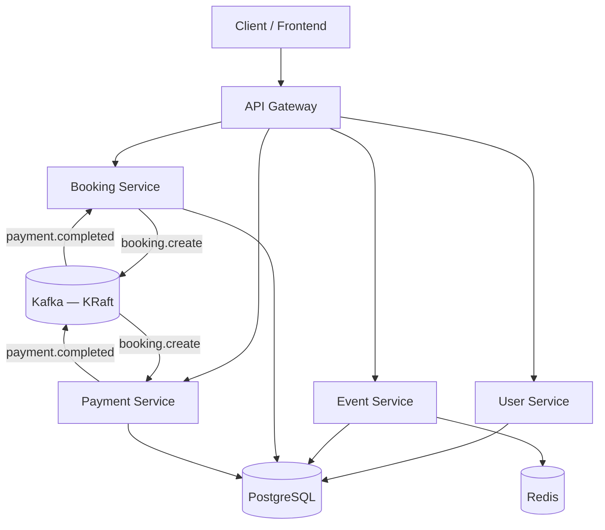
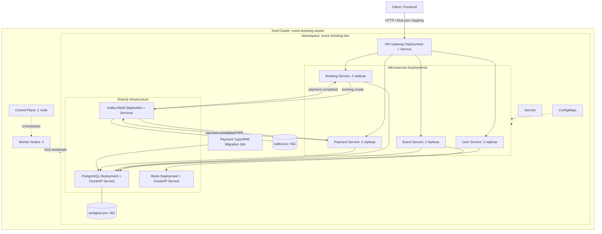

# Event Ticketing System — Infrastructure & DevOps

Infrastructure configuration and deployment resources for the **Event Ticketing System**, a microservices-based application built with Spring Boot and NestJS.

This repository supports local development with Docker Compose and a multi-node Kubernetes environment using **Kind**. It also serves as the home for planned cloud infrastructure, deployment automation, and observability work.

## Current implementation status

| Area | Status | Details |
|---|---|---|
| Local infrastructure | Implemented | Docker Compose for PostgreSQL, Redis and Kafka |
| Local application stack | Implemented | Separate Docker Compose application configuration |
| Local Kubernetes cluster | Implemented | Kind cluster with one control-plane and two worker nodes |
| Kubernetes infrastructure | Implemented | PostgreSQL, Redis and Kafka |
| Kubernetes microservices | Implemented | API Gateway, User, Event, Booking and Payment services |
| Kubernetes configuration | Implemented | Namespaces, ConfigMaps, Secrets, Services and persistent storage |
| Database migration | Implemented | One-off Kubernetes Job for Payment Service TypeORM migrations |
| CI | Implemented in service repositories | GitHub Actions test pipelines |
| AWS infrastructure | Planned | EKS, RDS, MSK, ElastiCache and ECR |
| Terraform, Helm and GitOps | Planned | Infrastructure provisioning and automated delivery |
| Observability | Planned | Prometheus, Grafana and Loki |

> **Scope:** The Kubernetes instructions below describe the current local Kind environment. AWS resources and monitoring components are roadmap items, not claimed as deployed.

## Architecture



Kafka event processing is asynchronous. A successful end-to-end booking/payment workflow requires the relevant topics, consumers, database migrations and event handlers to be configured and verified.

## Technology stack

| Layer | Technology |
|---|---|
| Application services | Spring Boot (Java 21), NestJS |
| Containers | Docker, Docker Compose |
| Kubernetes | Kind, kubectl, Kubernetes manifests |
| Messaging | Apache Kafka in KRaft mode |
| Data | PostgreSQL, Redis |
| CI | GitHub Actions |
| Planned IaC / cloud | Terraform, AWS EKS, RDS, MSK, ElastiCache, ECR |
| Planned delivery / observability | Helm, GitOps, Prometheus, Grafana, Loki |

## 1. Local development with Docker Compose

### Prerequisites

- Docker Engine or Docker Desktop with Compose support
- Git

The infrastructure and application Compose stacks use the shared `event-ticketing-network` bridge network. Application containers can resolve infrastructure components by their service DNS names.

### Start infrastructure and applications separately (recommended)

```bash
docker compose -f docker-compose.infra.yml up -d
docker compose -f docker-compose-app.yml up -d
```

### Start both stacks together

```bash
docker compose -f docker-compose.infra.yml -f docker-compose-app.yml up -d
```

### Stop the environment

```bash
docker compose -f docker-compose.infra.yml -f docker-compose-app.yml down --remove-orphans
```

**Warning:** Adding `-v` removes Compose-managed volumes and can delete local database or messaging data. Only use it when an intentional data reset is required.

## 2. Local Kubernetes environment (Kind)

### Cluster topology

| Setting | Value |
|---|---|
| Cluster name | `event-ticketing-cluster` |
| Control-plane nodes | 1 |
| Worker nodes | 2 |
| Application namespace | `event-ticketing-dev` |
| Host port mapping | `127.0.0.1:9090` → Kind control-plane port `30080` |

The Kind configuration maps the host port to a Kubernetes node port; the actual application exposed on that port depends on the currently deployed NodePort Service. Verify the Service configuration rather than assuming a particular application is reachable there.

### Deployed Kubernetes architecture diagram



> **Diagram scope:** This is a logical view of the deployed Kind environment, not a fixed per-node Pod placement map. Kubernetes schedules workloads on eligible nodes; the Kafka StatefulSet uses stable broker identity and persistent storage.

### Prerequisites

- Docker Engine / Docker Desktop
- `kind`
- `kubectl`
- Built application images available to the Kind cluster (via `kind load docker-image` or a registry)
- Kubernetes manifests from this repository

### Create or inspect the cluster

Use the repository's Kind configuration file (adjust the path to its actual location):

```bash
kind create cluster --name event-ticketing-cluster --config <path-to-kind-config.yaml>
kubectl config use-context kind-event-ticketing-cluster
kubectl get nodes -o wide
```

If the cluster already exists, skip creation and select its context.

### Namespace

The application resources are deployed in the `event-ticketing-dev` namespace, labeled `environment=development`.

```bash
kubectl get namespace event-ticketing-dev
kubectl get all -n event-ticketing-dev
```

Apply the namespace manifest before other namespaced resources. Use the actual paths in this repository when applying manifests.

## 3. Kubernetes resources

### Infrastructure workloads

| Component | Kubernetes resources | Notes |
|---|---|---|
| PostgreSQL | Deployment, ClusterIP Service, PVC, credentials Secret | Persistent relational data; databases used by microservices |
| Redis | Deployment, Service | Shared caching infrastructure |
| Kafka | StatefulSet, headless Service, client Service, PVC | Single-broker KRaft deployment for local development |

**Kafka configuration:**

- Image: `confluentinc/cp-kafka:7.5.0`
- Broker endpoint for in-cluster clients: `kafka:9092`
- Advertised broker endpoint: `kafka-0.kafka-headless.event-ticketing-dev.svc.cluster.local:9092`
- Broker and controller ports: `9092` and `9093`
- Single-broker replication factor: `1` (local development only)
- Topic auto-creation: disabled (`KAFKA_AUTO_CREATE_TOPICS_ENABLE=false`)
- Persistent volume claim: `kafka-pvc`, 5 GiB
- **Important:** Set `spec.template.spec.enableServiceLinks: false` on the Kafka StatefulSet to prevent Kubernetes from injecting `KAFKA_PORT`, which Confluent's startup script treats as a deprecated setting and exits with code 1.

The local single-broker Kafka deployment is **not highly available** and is not a production topology.

### Application workloads

| Workload | Technology | Container port | Kubernetes resource |
|---|---|---:|---|
| API Gateway | Spring Cloud Gateway | 9090 | Deployment + Service |
| User Service | Spring Boot | 8081 | Deployment + Service |
| Event Service | Spring Boot | 8082 | Deployment + Service |
| Booking Service | Spring Boot | 8083 | Deployment + Service |
| Payment Service | NestJS | 8084 | Deployment + Service |

Services communicate internally through Kubernetes DNS rather than Eureka. The application Deployments use Kubernetes configuration resources and service endpoints to connect to shared infrastructure.

### ConfigMaps and Secrets

**ConfigMaps** hold non-sensitive environment configuration such as service ports, database hosts, Kafka bootstrap addresses and application settings. Examples include `payment-service-config` and the service-specific configuration used by Spring Boot workloads.

**Secrets** hold sensitive values such as database credentials and JWT signing material. Examples include `postgres-credentials` and `jwt-secret`.

Never commit real credentials, JWT secrets, or production `.env` files. The local manifests should use development-only placeholders or a secure secret provisioning workflow. Kubernetes Secrets are not automatically equivalent to a managed secrets vault.

### Persistent storage

PostgreSQL and Kafka use PersistentVolumeClaims so data can survive container restarts and ordinary Pod recreation. For example:

- PostgreSQL: `postgres-pvc` (5 GiB in the local setup)
- Kafka: `kafka-pvc` (5 GiB)

Deleting a PVC or its underlying storage can permanently remove data. The Kind local-path StorageClass is intended for development and does not replace production storage and backup strategies.

### Database migrations

Payment Service database schema changes are executed by a **one-off Kubernetes Job**:

- Job: `payment-service-migration-v1`
- Image: `event-ticketing-payment-service:1.0.1` (local deployment version)
- Tool: TypeORM CLI
- Data source: `dist/database/data-source.js`

The migration command is:

```bash
./node_modules/.bin/typeorm migration:run -d dist/database/data-source.js
```

The Job creates/updates the payment database schema. The verified tables include `payments`, `processed_events`, `outbox_events` and `typeorm_migrations`.

```bash
kubectl get jobs -n event-ticketing-dev
kubectl logs job/payment-service-migration-v1 -n event-ticketing-dev
```

A migration Pod showing `0/1 Completed` is expected after the Job finishes successfully; it is not a running application Pod. Check Job conditions and logs to confirm success.

## 4. Deployment workflow

The exact manifest filenames and directory layout may differ by branch. Apply resources in dependency order using their real repository paths:

1. **Cluster and namespace:** Create the Kind cluster and apply the namespace.
2. **Configuration:** Apply development ConfigMaps and provision Secrets securely.
3. **Storage and infrastructure:** Apply PVCs, PostgreSQL, Redis and Kafka resources; wait for readiness.
4. **Kafka topics:** Provision required topics explicitly because auto-creation is disabled.
5. **Database migrations:** Run and verify the Payment Service migration Job.
6. **Application images:** Build/load images into Kind or configure a reachable registry.
7. **Microservices:** Apply User, Event, Booking, Payment and API Gateway Deployments and Services.
8. **Verification:** Check Pod readiness, logs, Service endpoints and end-to-end event flow.

### Loading a local image into Kind

```bash
kind load docker-image event-ticketing-payment-service:1.0.1 --name event-ticketing-cluster
```

Repeat for other locally built service images, using their actual tags.

### Provision Kafka topics

At minimum, the booking/payment integration uses `booking.create` and `payment.completed`. Create them after Kafka is ready; for a single local broker, use replication factor 1:

```bash
kubectl exec kafka-0 -n event-ticketing-dev -- \
  kafka-topics --bootstrap-server localhost:9092 \
  --create --if-not-exists --topic booking.create \
  --partitions 3 --replication-factor 1

kubectl exec kafka-0 -n event-ticketing-dev -- \
  kafka-topics --bootstrap-server localhost:9092 \
  --create --if-not-exists --topic payment.completed \
  --partitions 3 --replication-factor 1
```

Additional topics may be required by other application events. In a repeatable environment, topic provisioning should be automated through an infrastructure bootstrap step or Job rather than relying on manual commands.

### Inspect deployment status

```bash
kubectl get nodes
kubectl get pods -n event-ticketing-dev
kubectl get deployments,statefulsets,services,jobs,pvc -n event-ticketing-dev
kubectl get configmaps,secrets -n event-ticketing-dev
kubectl logs statefulset/kafka -n event-ticketing-dev --tail=100
```

Avoid printing Secret values in logs or screenshots.

## 5. Event-driven booking and payment flow

1. Booking Service creates a booking and publishes a `booking.create` event using the Outbox Pattern.
2. Payment Service's NestJS Kafka consumer subscribes to `booking.create` and processes the payment workflow.
3. Payment Service persists payment state and outgoing events using its database and outbox mechanism.
4. Payment Service's Outbox Publisher publishes `payment.completed` when payment completion is recorded.
5. Booking Service listens for `payment.completed` (consumer group `booking-service-group`) and updates the booking state.

Kafka topic presence and consumer group registration alone do **not** prove end-to-end processing. Verify application logs, committed offsets, database state, and idempotent handling. With multiple Payment Service replicas, the Outbox Publisher must coordinate event claims to prevent duplicate publishing.

### Kafka diagnostics

```bash
# List topics
kubectl exec kafka-0 -n event-ticketing-dev -- \
  kafka-topics --bootstrap-server localhost:9092 --list

# Inspect a topic
kubectl exec kafka-0 -n event-ticketing-dev -- \
  kafka-topics --bootstrap-server localhost:9092 \
  --describe --topic payment.completed

# List consumer groups
kubectl exec kafka-0 -n event-ticketing-dev -- \
  kafka-consumer-groups --bootstrap-server localhost:9092 --list

# Inspect the NestJS consumer group
kubectl exec kafka-0 -n event-ticketing-dev -- \
  kafka-consumer-groups --bootstrap-server localhost:9092 \
  --describe --group payment-service-group-server-server

# Follow Payment Service logs
kubectl logs -f -n event-ticketing-dev -l app=payment-service \
  --prefix=true --max-log-requests=10
```

**NestJS naming note:** The Kafka server transport appends a `-server` suffix to the configured consumer group ID. With a configured `payment-service-group-server`, the observed group was `payment-service-group-server-server`.

## 6. Troubleshooting notes

### Kafka CrashLoopBackOff: deprecated `port`

**Symptom:**

```text
Running in KRaft mode...
port is deprecated. Please use KAFKA_ADVERTISED_LISTENERS instead.
```

**Cause:** Kubernetes can inject a `KAFKA_PORT` environment variable from a Service named `kafka`. Confluent's Kafka startup script treats that variable as deprecated and exits with code 1.

**Fix:** Add this setting to the Kafka StatefulSet Pod template:

```yaml
spec:
  template:
    spec:
      enableServiceLinks: false
```

This disables service-linked environment variable injection, **not** Kubernetes DNS. Preserve existing PVCs and KRaft metadata while troubleshooting.

### Kafka producer metadata error

**Symptom:** `This server does not host this topic-partition`.

Check that the destination topic exists, partitions have leaders, and the broker's advertised listener is resolvable/reachable from application Pods. In this local environment, Kafka topic auto-creation is disabled.

### Migration Job shows `Completed`

A finished migration Pod showing `0/1 Completed` is normal. Review the Job status and logs; do not expect it to remain Running.

### Unexpected Pod restarts or `Unknown` status

Check node readiness, Pod events and recent container logs:

```bash
kubectl get nodes -o wide
kubectl get pods -n event-ticketing-dev -o wide
kubectl describe pod <pod-name> -n event-ticketing-dev
kubectl logs <pod-name> -n event-ticketing-dev --previous
```

## 7. Roadmap

The following are planned enhancements, not a description of the current Kind deployment:

- **Helm:** Package application and infrastructure manifests into reusable charts.
- **GitOps:** Introduce Argo CD to reconcile Kubernetes resources from Git.
- **CI/CD:** Extend GitHub Actions beyond tests to image publishing, security checks and automated deployments.
- **Code quality:** Integrate SonarQube and quality gates.
- **Observability:** Add Prometheus metrics, Grafana dashboards and Loki logs.
- **Terraform and AWS:** Provision EKS, RDS, MSK, ElastiCache, ECR and related networking/IAM resources.
- **Production readiness:** External secrets, multi-broker Kafka, managed databases, backup/restore, high availability, autoscaling and policy controls.

## Security and operational notes

- The Kind setup is a **development environment**, not a production-ready deployment.
- Never commit actual Secret values or production credentials.
- Do not delete Kafka/PostgreSQL PVCs as a routine troubleshooting step.
- Use versioned application images and review changes before rollout.
- Ensure event handlers are idempotent and outbox publishers are safe across replicas.

---

**Repository focus:** Repeatable infrastructure, container orchestration and a clear path from local development to automated cloud deployments.
